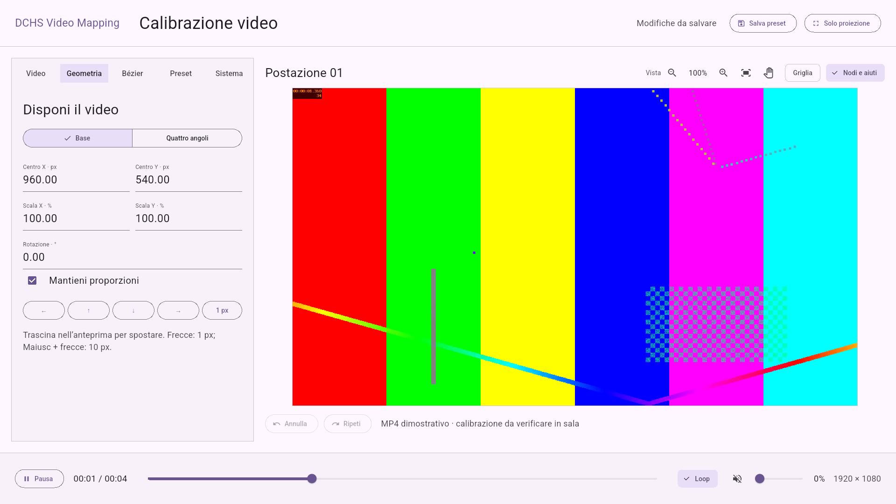

# DCHS Video Mapping

Player semplice per proiezioni e installazioni: un video locale, riproduzione in loop, calibrazione affine o a quattro angoli, sagoma di ritaglio Bézier. Android ≥ 24; riferimento Full HD 1920 × 1080. Funziona offline su un unico output: durante la manutenzione anche il proiettore mostra i controlli.



## Funzioni

- Video locale, loop, autoplay, play/pausa, timeline, volume e mute.
- Calibrazione affine o a quattro angoli, con griglia di riferimento.
- Una sagoma chiusa Bézier con nodi e maniglie, undo/redo e zoom/pan dell’editor.
- Preset locali, accesso operatore tramite PIN, diagnostica ed esportazione di configurazione/log.
- Proiezione a schermo intero, recupero dopo errori di configurazione e watchdog del player.

## Avvio e APK

Toolchain verificata: Flutter 3.47.5 / Dart 3.13.4, Java 21 per Gradle, target Java/Kotlin 17, Android SDK 36, AGP 9.1.0 / Gradle 9.3.1. Kotlin integrato attivo; `android.newDsl=false` e pin del compilatore mantenuti per i requisiti della toolchain Flutter corrente.

```sh
git clone https://github.com/dariocavada/dchs-video-mapping.git
cd dchs-video-mapping
flutter pub get
flutter run -d <id-dispositivo-android>
flutter build apk --debug --target lib/main.dart
```

APK locale: `build/app/outputs/flutter-apk/app-debug.apk`. ID applicazione: **`dev.dariocavada.dchs_video_mapping`**.

Il comando genera un APK debug. Per distribuire l’app configurare la firma e il dispositivo di destinazione; la configurazione `release` usa ancora la chiave debug: non distribuirla come versione firmata di produzione. Configurare una propria chiave prima di una distribuzione; mantenere keystore e `key.properties` fuori dal repository.

## Interfaccia e piattaforme

Il tema è Material 3 chiaro, con il colore `Colors.deepPurple` del template Flutter e caratteri di sistema. Il pannello di calibrazione mantiene un layout orizzontale 16:9, adattato alla dimensione disponibile. L’output di proiezione rimane nero dove non c’è video. L’interfaccia è in italiano.

È implementato solo Android: il bridge nativo per display, schermo acceso e kiosk non è disponibile su iOS, desktop o web. L’ID applicazione è `dev.dariocavada.dchs_video_mapping`. Non sono richiesti account, server o servizi cloud.

## Prima configurazione

1. Aprire il player e scegliere **Configura il player**. Creare e ripetere un PIN da 6 a 12 cifre: non esiste un valore predefinito. Il PIN è salvato con sale casuale e PBKDF2-HMAC-SHA256, 120.000 iterazioni; cinque errori consecutivi impongono 30 secondi di attesa.
2. Nella scheda **Video**, scegliere un file locale dal selettore Android. Il file viene copiato in streaming nello storage privato e aperto da un decoder candidato prima di sostituire il contenuto attivo. Annullamento, errore di copia o codec non leggibile conservano il precedente video e gli altri preset. Un ulteriore errore nell'applicazione conserva il decoder precedente.
3. Usare **Geometria** per centro X/Y in pixel di output, scale in percentuale e rotazione oraria. «Mantieni proporzioni» collega le scale. Trascinare l'anteprima per spostare il video. «Quattro angoli» usa un'omografia alternativa all'affine: angoli 1–4 in senso orario, partendo da alto sinistra. Un quadrilatero non valido lascia nell'anteprima l'ultima geometria valida e impedisce il salvataggio.
4. Usare **Bézier** per la sagoma: attivare il ritaglio, partire da un rettangolo o da un arco e trascinare nodi/maniglie. La maschera rimane ferma nello spazio di output quando si muove il video. Non deforma l'immagine interna.
5. Attivare **Griglia** per calibrare: bordo, centro e numeri attraversano le stesse trasformazioni, fit, specchio e ritaglio del video. Disattivarla e verificare il filmato prima della consegna.
6. Assegnare un nome nella scheda **Preset**, quindi **Salva preset**. **Solo proiezione** nasconde tutti gli aiuti e il cursore. Per una bozza non salvata si sceglie fra salvataggio, proiezione temporanea e ritorno all'editor. Dopo un riavvio viene usato il preset valido salvato, dall'inizio del video.

Il MP4 incluso è un segnale di prova animato originale generato con FFmpeg (`testsrc2`, H.264, 1920 × 1080, 25 fps, 4 secondi, senza audio): è un materiale dimostrativo, da sostituire con il proprio video. Si può rigenerare con:

```sh
ffmpeg -f lavfi -i 'testsrc2=size=1920x1080:rate=25:duration=4' \
  -an -c:v libx264 -preset fast -crf 25 -pix_fmt yuv420p \
  -movflags +faststart assets/demo.mp4
```

## Editor della sagoma

Un solo contorno chiuso, da 3 a 32 nodi, con segmenti cubici. Cerchi per i nodi e quadrati per le maniglie; i pulsanti **Entrante / Nodo / Uscente** permettono di scegliere componenti sovrapposti. La selezione sul canvas usa una zona di presa allargata rispetto ai marker. Un nodo trascinato porta con sé entrambe le maniglie; «Nodo morbido» mantiene le maniglie collineari, con lunghezze indipendenti.

**Aggiungi nodo** richiede un tocco sulla curva: suddivide il segmento con de Casteljau, senza modificarne inizialmente la forma. **Elimina nodo** non scende sotto tre nodi. Coordinate numeriche, pulsanti direzionali e frecce regolano il componente selezionato. Passo da 1 pixel di output o 10 pixel; con tastiera, Maiusc + freccia usa 10 pixel anche se l'anteprima è ridotta.

**Annulla / Ripeti** riguardano calibrazione, sagoma, fit, specchio e riferimenti dell'output. Un trascinamento intero è una sola operazione. Import del video, audio, loop, autoplay e nome non vengono cambiati dall'undo geometrico, così contenuto e preset rimangono coerenti. Ctrl + Z / Ctrl + Maiusc + Z; Ctrl + S salva. I campi numerici accettano anche la virgola decimale e applicano il valore con Invio o perdita di focus.

La validazione rifiuta coordinate non finite, nodi fuori `[0,1]`, maniglie fuori `[-1,2]`, ID ripetuti, area insufficiente e auto-intersezioni. Le curve vengono approssimate adattivamente nel raster di output con tolleranza 0,5 px per il controllo dei segmenti; il rendering conserva le curve cubiche originali e un bordo antialias. Durante una bozza invalida resta applicata l'ultima sagoma valida, con errore consultabile nell'editor. Non si può salvare o passare in proiezione una bozza invalida.

### Maniglie fuori dal bordo e vista dell’editor

Se la curva in alto richiede una maniglia sopra l’immagine, selezionare **Entrante** o **Uscente** e usare **Inquadra tutte le maniglie** (icona dei quattro angoli aperti, sopra l’anteprima). La vista lascia un margine intorno all’output, comprendendo anche i punti di controllo esterni. Con i pulsanti zoom si può lavorare dal 20% al 400%; la rotella del mouse ingrandisce intorno al cursore. Il pulsante con la **mano** permette di trascinare soltanto l’area di lavoro; disattivarlo per tornare a modificare la curva. **Inquadra output** riporta la vista al 100% e la ricentra.

La cornice individua il raster del proiettore; lo spazio esterno serve a prendere le maniglie. Il pan e lo zoom della vista sono temporanei, esclusi dal preset e dalla cronologia geometrica: non spostano né ridimensionano il video proiettato. Nudge e coordinate numeriche rimangono espressi in pixel di output. In alternativa si può inserire **Punto Y** negativo per una maniglia sopra il bordo: per esempio `-100` significa 100 pixel sopra l’output. I nodi restano dentro il raster; le maniglie conservano l’intervallo di lavoro `[-1,2]` normalizzato.

Il riferimento di interazione è il flusso di MadMapper: zoom e adattamento della vista sono descritti nella [guida dell’interfaccia](https://madmapper.com/files/01-Introduction%20to%20the%20User%20Interface.pdf); lo spostamento del viewport durante la costruzione delle maschere è documentato nella [guida delle maschere](https://madmapper.com/files/04-Masking.pdf). Si tratta delle guide ufficiali scaricabili, non di una verifica dal vivo del software MadMapper.

## Preset, recupero e manutenzione

- **Carica preset**: anteprima della calibrazione selezionata; salvarla per renderla quella usata all'avvio. La scelta avvisa se abbandona una bozza modificata. La lista è paginata.
- **Duplica**: crea un ID indipendente e salva con un nuovo nome, senza cancellare gli altri preset.
- **Ripristina copia precedente**: richiama il preset attivo nella precedente revisione valida dell'archivio; verificare e salvare per applicarlo all'avvio.
- **Azzera geometria e sagoma**: chiede conferma, conserva il video e gli altri preset; operazione annullabile.
- **Sistema**: diagnostica, export di configurazione/log, cambio PIN con verifica del precedente, licenze e stato kiosk.

Dalla proiezione tenere premuto per **3 secondi nell'angolo alto sinistro**, oppure usare **Ctrl + M**, quindi inserire il PIN. Il PIN dimenticato richiede intervento tecnico sullo storage privato; non c'è un codice universale di sblocco. Uscire sempre con «Solo proiezione» dopo la manutenzione.

Storage privato sotto `getApplicationSupportDirectory()/player/`:

```text
media/                  file importati con nomi gestiti dall'app
presets.json            archivio schema 1 con preset attivo e libreria
presets.backup.json     precedente snapshot valido
access.json             credenziali locali, escluse dagli export
logs/player*.log        cinque file da circa 1 MiB ciascuno
```

I preset vengono validati e scritti su temporaneo con flush e rename. Una primaria corrotta viene recuperata dal backup, senza copiarla sopra l'unica copia valida al salvataggio successivo. Media mancanti, configurazione invalida e decoder in errore producono **nero nell'output pubblico**; la diagnosi si legge dopo l'accesso del personale. Gli aggiornamenti installati con lo stesso ID/firma preservano i dati; disinstallazione o cancellazione dati li rimuovono. I media importati non vengono eliminati automaticamente perché possono essere riferiti da altri preset o backup.

L'esportazione crea in un isolate uno ZIP con preset salvati, bozza e log. Esclude PIN e video: copiare separatamente i master per avere un backup completo. Il pannello di condivisione Android viene aperto su richiesta; l'app non invia automaticamente ad alcuna destinazione. La versione 1 non offre un importatore ZIP: per ripristini completi serve intervento tecnico a app chiusa.

## Riproduzione e output

`video_player` **2.14.1**, backend Android **2.12.2**, vista texture. Loop nativo; timeline, play/pausa, mute e volume. Il comando di pausa viene rispettato quando si ritorna dal selettore file o dal background; autoplay decide soltanto lo stato iniziale di un video appena aperto. Con loop disattivato, Riproduci riavvia un video terminato con un solo clic.

Il watchdog controlla l'avanzamento ogni secondo: oltre 5 secondi senza progresso, esclusi pausa, sospensione, buffering dichiarato e completamento, reinizializza il backend. Massimo tre recuperi, attese 1/2/4 secondi, poi nero e diagnosi. Mantiene l'intento play/pausa anche durante il recupero. Un loop che riporta la posizione all'inizio conta come avanzamento. Per riprovare manualmente un errore definitivo, caricare nuovamente un preset o importare il media corretto.

La calibrazione memorizza raster fisico e identità/configurazione del display. Un cambio di dimensioni o identità rende nero l'output pubblico e mostra un avviso in manutenzione: verificare e confermare **Ricalibra output**, poi salvare. La conferma riferisce le coordinate normalizzate al nuovo raster; non certifica l'allineamento fisico. Gestione HDMI e refresh richiedono comunque prova sul dispositivo definitivo.

L'app usa landscape, immersive sticky, schermo acceso e Back gestito. Può richiedere lock task solo se un **DPC/device owner** autorizza il suo package. Non usa screen pinning come sostituto del kiosk. Configurare tramite il sistema di gestione avvio dopo accensione, launcher, notifiche, aggiornamenti e uscita autorizzata; non viene promesso un avvio automatico tramite un generico broadcast Android. Nessun secondo display indipendente, mesh warp, multi-proiettore, edge blending o sincronizzazione tra installazioni.

Formato di riferimento: MP4 H.264 4:2:0, Full HD progressivo, 25/30 fps costanti, AAC se presente. Il formato va certificato sul decoder effettivo; MOV, HEVC, AV1 e altri codec non hanno una garanzia universale. Riferimenti: [plugin ufficiale](https://pub.dev/packages/video_player), [formati Media3](https://developer.android.com/media/media3/exoplayer/supported-formats), [selettore file](https://pub.dev/packages/file_selector).

## Screenshot

Screenshot reali del test su emulatore Android 36 a 1920 × 1080:

- [Prima configurazione](docs/screenshots/00-player-setup-android.png)
- [Editor Bézier](docs/screenshots/02-player-maschera-bezier-android.png)
- [Solo proiezione con ritaglio](docs/screenshots/03-player-proiezione-bezier-android.png)
- [Calibrazione a quattro angoli](docs/screenshots/04-player-quattro-angoli-android.png)

## Verifica e licenze

```sh
flutter analyze
flutter test
flutter drive --driver=test_driver/integration_driver.dart \
  --target=integration_test/player_test.dart -d <id-emulatore>
# Il test usa dati separati e il PIN di test non è un PIN predefinito.
# Il drive produce un APK di test: ricompilare main.dart prima della consegna.
flutter build apk --debug --target lib/main.dart
```

La verifica del progetto autonomo è riportata in [docs/validation.md](docs/validation.md). Il drive salva gli screenshot in `docs/screenshots/` e usa uno storage di test separato. Per riprodurre gli screenshot Full HD, su un emulatore dedicato impostare `adb -s <id-emulatore> shell wm size 1920x1080` e `adb -s <id-emulatore> shell wm density 160`; al termine ripristinare con gli stessi comandi usando `reset`. Non applicare questi comandi al dispositivo di proiezione. Prestazioni, sessioni prolungate, livello del nero, alimentazione e HDMI vanno verificati sul dispositivo e proiettore effettivi.

Il codice del progetto è distribuito con [licenza MIT](LICENSE). Il segnale video dimostrativo è generato tramite FFmpeg; non vengono inclusi filmati di terzi. Le dipendenze mantengono le rispettive licenze: consultare [THIRD_PARTY_NOTICES.md](THIRD_PARTY_NOTICES.md) e **Sistema → Licenze** nell’app.

## Struttura del progetto

```text
lib/app/             avvio, sessione e flusso operatore/proiezione
lib/operator_ui/     pannelli Material e canvas di calibrazione
lib/mapping/         trasformazioni, curve e undo/redo
lib/output/          rendering e ritaglio dell’output
lib/playback/        controller video, backend e watchdog
lib/presets/         schema e persistenza dei preset
lib/infrastructure/  import, PIN, log, export e bridge Android
android/             host nativo, display e lock task
assets/              segnale video dimostrativo e licenze native
test/                test unitari e widget
integration_test/    flusso completo con decoder Android reale
```

Per contribuire: eseguire `dart format lib test integration_test test_driver`, `flutter analyze` e `flutter test` prima di aprire una pull request. Per modifiche a riproduzione o bridge nativo eseguire anche il test Android. Non includere video personali, preset reali, credenziali, chiavi di firma o log del dispositivo nelle pull request.
