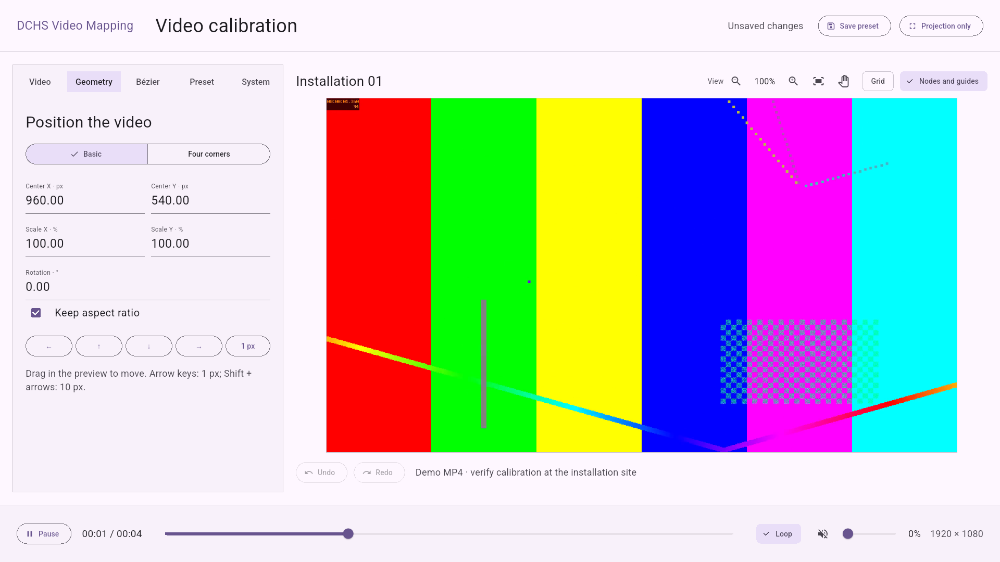

# DCHS Video Mapping

A simple player for projections and installations: one local video, loop playback, affine or four-corner calibration, and a Bézier clipping mask. Android ≥ 24, iOS/iPadOS ≥ 15 and macOS ≥ 12; Full HD 1920 × 1080 reference output. Runs offline on a single output: the projector also shows the controls during maintenance.



## Features

- Local video, loop, autoplay, play/pause, timeline, volume and mute.
- Affine or four-corner calibration with a reference grid.
- One closed Bézier mask with nodes and handles, undo/redo, and editor zoom/pan.
- Local presets, operator access via PIN, diagnostics, and configuration/log export.
- Full-screen projection, recovery from configuration errors, and a playback watchdog.

## Getting started and building

Verified toolchain: Flutter 3.47.5 / Dart 3.13.4, Java 21 for Gradle, Java/Kotlin target 17, Android SDK 36, AGP 9.1.0 / Gradle 9.3.1. Built-in Kotlin is enabled; `android.newDsl=false` and the compiler version pin are retained to meet the current Flutter toolchain requirements.

```sh
git clone https://github.com/dariocavada/dchs-video-mapping.git
cd dchs-video-mapping
flutter pub get
flutter run -d <android-device-id>
flutter build apk --debug --target lib/main.dart
```

Android APK: `build/app/outputs/flutter-apk/app-debug.apk`. Android application ID: **`dev.dariocavada.dchs_video_mapping`**.

This command produces a debug APK. Configure signing and the target device before distributing the app. The `release` configuration still uses the debug key: do not distribute it as a production-signed release. Set up your own signing key before distribution; keep the keystore and `key.properties` out of the repository.

### X96 X10Pro with Android 11

On the physically tested `X96_X10Pro` (Amlogic, API 30), the firmware limits video texture output to 14 buffers. Flutter's ImageReader path requires at least 18 and fails to initialize `OMX.amlogic.avc.decoder.awesome2`, even though the decoder reports the Full HD H.264 format as supported. This matches the class of device incompatibility tracked in [Flutter issue 155355](https://github.com/flutter/flutter/issues/155355).

The Android host selects GLES and SurfaceTexture on this exact model/OS combination, preserving a compositable texture for geometry and Bézier clipping. This compatibility path uses Flutter's `debugForceSurfaceProducerGlTextures` testing API, and Impeller opt-out is deprecated: revalidate both on Flutter engine upgrades. The original demo remains H.264 High, 1920 × 1080, 25 fps. `integration_test/android_box_playback_test.dart` checks native initialization, advancing playback, two loops and seeking using temporary files, without setting a staff PIN.

### Automatic startup on Android

In the PIN-protected **System** tab, enable **Start automatically when the box turns on**. Confirm **DCHS Video Mapping** as the Home app in Android's dialog. The checkbox reflects the actual Home selection and any required permission; cancelling the setup leaves it unchecked. Android then launches the player as Home after boot, and the player loads its saved preset. This requires a device that permits choosing its Home app; verify it with a real reboot on the intended firmware.

The tested X96 X10Pro firmware explicitly opens its factory launcher at boot even when another Home is selected. On this exact Android 11 model, setup also requests **Display over other apps**: open the DCHS Video Mapping entry, allow access, then go back to the player. If Android asks which Settings app to use, choose the entry labelled **Display over other apps**. The permission allows the `BOOT_COMPLETED` fallback to open the selected player under Android 11's [background activity restrictions](https://developer.android.com/guide/components/activities/secure-bal); the player creates no overlay windows. This extra permission is not requested on other models. A real reboot on the tested box confirmed automatic startup with the saved video and mask.

**Home** returns to the player while this option is active. **Open Android home** in the same staff panel opens the previous launcher without disabling automatic startup. Uncheck the option to remove the player's optional Home entry; Android can then use another launcher. A managed kiosk must be exited using its administrator's procedure before changing Home settings.

Android displays a temporary **CavadaLabs** wordmark on black while the player's local data opens. This is the app's loading screen; the firmware boot logo is separate. The controls and branding are Android-only.

Standby is separate from a full boot. When the player returns to the foreground, its existing lifecycle handler resumes playback and checks the output again. It does not launch over another app whenever the screen turns on. Screen-on events cannot be received through a manifest-only receiver and do not guarantee restarting a terminated process; see Android's [broadcast documentation](https://developer.android.com/develop/background-work/background-tasks/broadcasts).

### macOS

```sh
flutter run -d macos
flutter build macos --debug
```

The local app is `build/macos/Build/Products/Debug/DCHS Video Mapping.app`. Move the window to the intended display and use **View → Enter Full Screen** (Ctrl + Command + F) before calibrating and saving. Resizing the window or changing displays requires confirming **Recalibrate output**. The window uses native full-screen controls; **Projection only** hides the editor within the current window. Command + S saves; Command + Z / Command + Shift + Z undo/redo; Command + M opens staff access. Ctrl shortcuts remain available.

The Mac app runs in the App Sandbox with read access to files selected by the user. Imported video is copied into the app container, so saved presets do not depend on continued access to the original file. The app prevents display idle sleep while running. Full screen does not provide a kiosk lock. The debug build is for local testing; public binary distribution requires your own signing and notarization.

### iOS and iPadOS

```sh
flutter devices
flutter run -d <iphone-or-ipad-simulator-id>
flutter build ios --simulator --debug
# Build for a physical device without signing; this is not an installable IPA.
flutter build ios --debug --no-codesign
```

The simulator app is `build/ios/iphonesimulator/Runner.app`. For a physical iPhone/iPad, open `ios/Runner.xcworkspace` in Xcode and select your own development team and provisioning settings. No personal signing team is committed. The Apple bundle ID is `dev.dariocavada.dchsVideoMapping` on both iOS and macOS.

The app uses landscape orientation and keeps the display awake while active. Import video through the Files picker; preset storage, PIN access, playback and ZIP sharing use the same workflow as Android. Configure Guided Access or supervised Single App Mode separately if the installation requires restricted access. This version renders in one app window; external display mirroring and adapters require physical testing. It does not create a separate projector window.

## Interface and platforms

The interface uses a light Material 3 theme with `Colors.deepPurple` from the Flutter template and system fonts. The calibration panel keeps a horizontal 16:9 layout, scaled to the available space. The projection output stays black wherever there is no video. The interface is in English.

Android, iOS/iPadOS and macOS are implemented. They share the video player, editor and private preset storage; native hosts provide display information and keep the screen awake. Managed lock task is Android-only. Windows and web are not implemented. No accounts, servers or cloud services are required.

## First setup

1. Open the player and choose **Set up player**. Create and repeat a PIN of 6 to 12 digits: there is no default PIN. The PIN is stored using a random salt and PBKDF2-HMAC-SHA256 with 120,000 iterations; five consecutive failures trigger a 30-second wait.
2. In the **Video** tab, choose a local file using the system file picker. The file is streamed into private storage and opened by a candidate decoder before replacing the active content. Cancellation, a copy failure or an unreadable codec preserves the previous video and other presets. A subsequent failure to apply the video also preserves the previous decoder.
3. Use **Geometry** to set the X/Y center in output pixels, scales as percentages, and clockwise rotation. **Keep aspect ratio** links the scales. Drag the preview to move the video. **Four corners** uses a homography as an alternative to the affine transform: corners 1–4 run clockwise from the top left. An invalid quadrilateral keeps the last valid geometry in the preview and blocks saving.
4. Use **Bézier** for the mask: enable clipping, start from a rectangle or arch, and drag nodes/handles. The mask stays fixed in output space when the video moves. It does not warp the image inside it.
5. Enable **Grid** to calibrate: the border, center and numbers follow the same transforms, fit, mirroring and clipping as the video. Disable it and check the footage before handover.
6. Enter a name in the **Preset** tab, then choose **Save preset**. **Projection only** hides all guides and the cursor. For an unsaved draft, choose between saving, temporary projection, and returning to the editor. After a restart, the valid saved preset is used and the video starts from the beginning.

The included MP4 is an original animated test signal generated with FFmpeg (`testsrc2`, H.264, 1920 × 1080, 25 fps, 4 seconds, no audio). It is demo material; replace it with your own video. To regenerate it:

```sh
ffmpeg -f lavfi -i 'testsrc2=size=1920x1080:rate=25:duration=4' \
  -an -c:v libx264 -preset fast -crf 25 -pix_fmt yuv420p \
  -movflags +faststart assets/demo.mp4
```

## Mask editor

A single closed contour with 3 to 32 nodes and cubic segments. Circles represent nodes; squares represent handles. The **Incoming / Node / Outgoing** buttons let you select overlapping components. Canvas selection uses a larger hit area than the visible markers. Dragging a node moves both handles with it; **Smooth node** keeps the handles collinear, with independent lengths.

**Add node** requires a tap on the curve: it splits the segment using de Casteljau without initially changing its shape. **Delete node** keeps at least three nodes. Numeric coordinates, directional buttons and arrow keys adjust the selected component. The step is 1 or 10 output pixels; on a keyboard, Shift + arrow moves by 10 pixels even when the preview is scaled down.

**Undo / Redo** cover calibration, mask, fit, mirroring and output references. A whole drag counts as one operation. Geometric undo does not change video imports, audio, loop, autoplay or the preset name, keeping content and presets consistent. Ctrl + Z / Ctrl + Shift + Z undo/redo; Ctrl + S saves. On Mac, Command works in place of Ctrl. Numeric fields also accept a decimal comma and apply the value on Enter or loss of focus.

Validation rejects non-finite coordinates, nodes outside `[0,1]`, handles outside `[-1,2]`, duplicate IDs, insufficient area and self-intersections. Curves are adaptively approximated in the output raster with a 0.5 px tolerance for segment checks; rendering retains the original cubic curves and an antialiased edge. While a draft is invalid, the last valid mask remains applied, with an error shown in the editor. An invalid draft cannot be saved or projected.

### Handles outside the frame and the editor view

If the curve at the top requires a handle above the image, select **Incoming** or **Outgoing** and use **Fit all handles** (the four open corners icon above the preview). The view leaves a margin around the output, including control points outside the frame. The zoom buttons cover 20% to 400%; the mouse wheel zooms around the cursor. The **hand** button lets you pan the workspace only; turn it off to resume curve editing. **Fit output** resets the view to 100% and centers it.

The frame marks the projector raster; the space outside it lets you reach the handles. View pan and zoom are temporary and excluded from presets and geometric history: they do not move or resize the projected video. Nudges and numeric coordinates remain in output pixels. Alternatively, enter a negative **Point Y** for a handle above the frame: for example, `-100` means 100 pixels above the output. Nodes stay inside the raster; handles retain the normalized working range `[-1,2]`.

The interaction reference is the MadMapper workflow: zooming and fitting the view are described in the [user interface guide](https://madmapper.com/files/01-Introduction%20to%20the%20User%20Interface.pdf); moving the viewport while building masks is documented in the [masking guide](https://madmapper.com/files/04-Masking.pdf). These are the official downloadable guides; the MadMapper software itself was not tested live.

## Presets, recovery and maintenance

- **Load preset** previews the selected calibration; save it to make it the startup preset. Loading warns before discarding a modified draft. The list is paginated.
- **Duplicate with a new name** creates an independent ID and saves under a new name without deleting other presets.
- **Restore previous copy** recalls the active preset from the previous valid archive revision; check and save it to apply it on startup.
- **Reset geometry and mask** asks for confirmation and keeps the video and other presets; the operation can be undone.
- **System** provides diagnostics, configuration/log export, PIN changes with verification of the old PIN, licenses and kiosk status.

From projection, **hold the top-left corner for 3 seconds**, or press **Ctrl + M** (**Command + M** on Mac), then enter the PIN. A forgotten PIN requires technical intervention in private storage; there is no universal unlock code. Always leave maintenance using **Projection only**.

Private storage under `getApplicationSupportDirectory()/player/`:

```text
media/                  imported files with app-managed names
presets.json            schema 1 archive with active preset and library
presets.backup.json     previous valid snapshot
access.json             local credentials, excluded from exports
logs/player*.log        five files of approximately 1 MiB each
```

Presets are validated and written to a temporary file with flush and rename. A corrupt primary archive is recovered from the backup without overwriting the only valid copy on the next save. Missing media, invalid configuration and decoder errors produce **black on the public output**; diagnostics are available after staff access. Updates installed with the same ID/signature preserve data; uninstalling or clearing app data removes it. Imported media are not deleted automatically because other presets or backups may reference them.

Export creates a ZIP in an isolate containing saved presets, the draft (`draft.json`) and logs. It excludes the PIN and videos: copy the masters separately for a complete backup. The system share sheet opens on request; the app does not automatically send anything to a destination. Version 1 has no ZIP importer: a full restore requires technical intervention with the app closed.

## Playback and output

`video_player` **2.14.1**, Android backend **2.12.2** and Apple AVFoundation backend **2.12.1**, texture view. Native loop playback, timeline, play/pause, mute and volume. A pause command is respected when returning from the file picker or background; autoplay only determines the initial state of a newly opened video. With loop disabled, **Play** restarts a completed video with a single click.

The watchdog checks progress every second. After more than 5 seconds without progress, excluding pause, suspension, reported buffering and completion, it reinitializes the backend. It allows at most three recoveries with delays of 1/2/4 seconds, then shows black and records diagnostics. It preserves play/pause intent during recovery. A loop returning the position to the beginning counts as progress. To retry a terminal error manually, reload a preset or import the correct media.

Calibration stores the physical raster and display identity/configuration. A size or identity change makes the public output black and shows a maintenance warning: check and confirm **Recalibrate output**, then save. Confirmation maps the normalized coordinates to the new raster; it does not certify physical alignment. HDMI, external adapters, mirroring and refresh behavior still require testing on the final device. On Mac, calibration uses the physical pixels of the app content area, so enter full screen on the target display first.

On Android, the app uses landscape orientation, immersive sticky mode, a screen wake lock, and handles Back navigation. The optional Home selection described above provides startup after power-on; it does not lock the device. The app can request lock task mode only if a **DPC/device owner** authorizes its package. It does not use screen pinning as a substitute for kiosk mode. Configure notifications, updates and authorized kiosk exit through the device management system. There is no independent second display, mesh warp, multi-projector support, edge blending or synchronization between installations.

Reference format: MP4 H.264 4:2:0, progressive Full HD, constant 25/30 fps, AAC if audio is present. Certify the format on the actual decoder; MOV, HEVC, AV1 and other codecs have no universal compatibility guarantee. References: [official plugin](https://pub.dev/packages/video_player), [Media3 formats](https://developer.android.com/media/media3/exoplayer/supported-formats), [file picker](https://pub.dev/packages/file_selector).

## Screenshots

Actual screenshots from the Android 36 emulator test at 1920 × 1080:

- [First setup](docs/screenshots/00-player-setup-android.png)
- [Bézier editor](docs/screenshots/02-player-bezier-mask-android.png)
- [Projection only with clipping](docs/screenshots/03-player-bezier-projection-android.png)
- [Four-corner calibration](docs/screenshots/04-player-four-corners-android.png)

Apple runtime screenshots:

- [macOS geometry editor](docs/screenshots/01-player-geometry-macos.png)
- [macOS Bézier editor](docs/screenshots/02-player-bezier-mask-macos.png)
- [iPhone geometry editor](docs/screenshots/01-player-geometry-ios.png)
- [iPhone Bézier editor](docs/screenshots/02-player-bezier-mask-ios.png)
- [iPad Bézier editor](docs/screenshots/02-player-bezier-mask-ipados.png)

## Verification and licenses

```sh
flutter analyze
flutter test
flutter drive --driver=test_driver/integration_driver.dart \
  --target=integration_test/player_test.dart -d <emulator-id>
# The test uses separate data; its test PIN is not a default PIN.
# Drive produces a test APK: rebuild main.dart before handover.
flutter build apk --debug --target lib/main.dart
# Run the same flow on Apple platforms.
flutter drive --driver=test_driver/integration_driver.dart \
  --target=integration_test/player_test.dart -d macos
flutter drive --driver=test_driver/integration_driver.dart \
  --target=integration_test/player_test.dart -d <ios-simulator-id>
# Rebuild lib/main.dart after an integration run on any platform.
```

Verification of the standalone project is recorded in [docs/validation.md](docs/validation.md). The drive saves screenshots in `docs/screenshots/` and uses separate test storage. To reproduce Full HD screenshots, set `adb -s <emulator-id> shell wm size 1920x1080` and `adb -s <emulator-id> shell wm density 160` on a dedicated emulator; restore both using the same commands with `reset` when finished. Do not apply these commands to the projection device. Performance, extended sessions, black level, power and HDMI must be tested on the actual device and projector.

The project code is distributed under the [MIT license](LICENSE). The demo video signal is generated with FFmpeg; no third-party footage is included. Dependencies retain their respective licenses: see [THIRD_PARTY_NOTICES.md](THIRD_PARTY_NOTICES.md) and **System → Licenses** in the app.

## Project structure

```text
lib/app/             startup, session and operator/projection flow
lib/operator_ui/     Material panels and calibration canvas
lib/mapping/         transforms, curves and undo/redo
lib/output/          output rendering and clipping
lib/playback/        video controller, backend and watchdog
lib/presets/         preset schema and persistence
lib/infrastructure/  import, PIN, logs, export and platform bridge
android/             native host, display and lock task
ios/                 Swift host, display and idle timer
macos/               Swift host, display, full screen and idle sleep prevention
assets/              demo video signal and native licenses
test/                unit and widget tests
integration_test/    complete flow with actual Android and Apple decoders
```

To contribute, run `dart format lib test integration_test test_driver`, `flutter analyze` and `flutter test` before opening a pull request. For playback or native bridge changes, also run integration tests on the affected platforms. Do not include personal videos, real installation presets, credentials, signing keys or device logs in pull requests.
